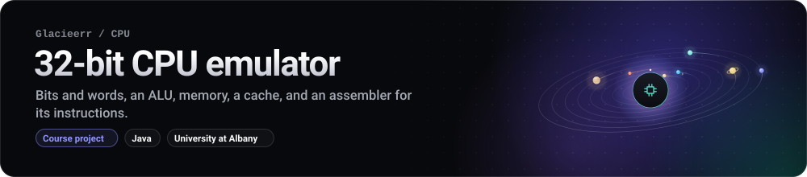

<picture>
  <source media="(prefers-color-scheme: light)" srcset=".github/readme/header-light.svg">
  
</picture>

**A software model of a simple 32-bit CPU in Java, with an assembler: bits and words, an ALU, memory, a stack, an instruction cache and a processor loop, plus a lexer and parser that turn assembly-style text into instructions.**

Course project, Computer Science, University at Albany (SUNY).

## What's inside

| Part | Files |
|---|---|
| Bits and 32-bit words | `Bit.java`, `Word.java` |
| Arithmetic and logic | `ALU.java` |
| Memory, stack and cache | `MainMemory.java`, `Stack.java`, `InstructionCache.java` |
| The processor loop and instructions | `Processor.java`, `Instruction.java` |
| Assembler: text to instructions | `Lexer.java`, `Parser.java`, `Token.java`, `TokenType.java` |

The instruction set includes math, copy, branch and jump, call and return, push, pop and peek, load and store, and halt.

## How to run

The repository holds the classes only: there is no `main` method to start from.

## Tests

There are no automated tests in this repository.

## Tech stack

Java, standard library only.

<!-- License (R3.3 #162): not chosen yet, so until a LICENSE file is added all rights are reserved.
     Course work: check the school's rules on publishing coursework before choosing.
     When decided, add LICENSE and put this section here, e.g.
## License

[MIT](LICENSE) © 2026 Canyuan Ye
-->

---

中文：课程项目，纽约州立大学奥尔巴尼分校计算机科学。用 Java 模拟一个简单的 32 位 CPU（位和字、ALU、内存、栈、指令缓存、处理器循环），并带汇编器：词法和语法分析把汇编式文本转成指令。仓库里只有这些类，没有 `main` 入口，也没有自动化测试。
